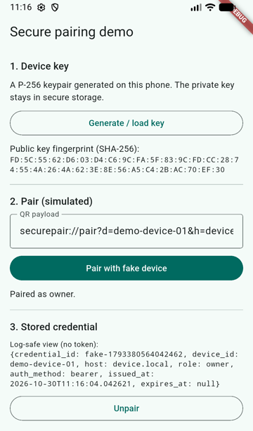

# flutter_secure_pairing

[](https://github.com/levi-stoddard/flutter_secure_pairing/actions/workflows/ci.yml)

On-device EC key generation, secure-storage-backed device identity, and a transport-agnostic pairing flow for Flutter apps that pair a phone with local hardware: a camera, a sensor hub, a boat or vehicle controller.

I extracted and generalized this from the pairing code in a production marine IoT app I build (see the [app showcase](https://github.com/levi-stoddard/binnacle-connect-showcase)). All product-specific protocol details have been replaced with a neutral example format, so you can adapt the format and keep the security logic.



## What it does

1. **Generates a device key on the phone.** A NIST P-256 keypair is created once with `basic_utils`/`pointycastle`. The private key is written only to platform secure storage (`flutter_secure_storage`: Keystore-backed encrypted storage on Android, the Keychain on iOS) and no public API returns it.
2. **Encodes the public key.** You get it as a SubjectPublicKeyInfo PEM block, a SHA-256 fingerprint for people to compare, and a PKCS#10 CSR if the other side issues certificates.
3. **Parses the device's QR label.** The example format `securepair://pair?d=<device_id>&h=<host>&f=<cert_fingerprint>` identifies the device and carries no secret.
4. **Sends a pairing request through an interface.** `PairingTransport` hides how the request reaches the device. `FakePairingTransport` runs fully in memory for tests and demos. `HttpPairingTransport` is a reference HTTPS implementation with a bounded timeout and a status-code mapping in which no network error ever throws.
5. **Persists the issued credential.** `SecureCredentialStore` keeps it in secure storage. `toJsonSafe()` gives a log-friendly view that never contains the token.

## Threat model

- **Someone photographs the QR label.** They gain nothing: the payload carries no credential, and the device should only issue one while a pairing window is open (for example, after a physical button press). Physical access is the root of trust.
- **The pairing traffic is intercepted.** Only the public key and a display name go to the device. The private key never leaves the phone, so a captured request can't be used to impersonate it later. Pin `certFingerprint` from the QR code to defend the response path.
- **The device is claimed by the wrong person.** If the device reports it had no previous owner, `PairingResult.deviceWasUnclaimed` is set so the app can make the user confirm, which is expected out of the box but suspicious on a used device. The example app shows this.
- **Secrets leak through logs or backups.** Tokens and keys are stored only through `flutter_secure_storage`, never `SharedPreferences`. `PairingCredential.toJsonSafe()` omits the token, and corrupt stored data fails closed to "unpaired" instead of crashing.
- **Role confusion or stale credentials.** Unknown roles parse as `viewer`, and an expired credential makes `PairingService.role` fall back to `viewer`. Client-side role checks are only for the UI; the device must enforce permissions itself.
- **Network failures are handled.** Timeouts, refused connections and certificate errors become `PairingOutcome.unreachable`, and malformed responses become `refused`. Nothing throws into the UI.

## Usage

```yaml
dependencies:
  flutter_secure_pairing:
    git: https://github.com/levi-stoddard/flutter_secure_pairing
```

```dart
import 'package:flutter_secure_pairing/flutter_secure_pairing.dart';

final pairing = PairingService(
  transport: HttpPairingTransport(), // or your own PairingTransport
);
await pairing.restore(); // reload a credential saved earlier

final target = PairingTarget.tryParse(scannedQrText);
if (target == null) { /* not a pairing code */ }

final result = await pairing.pair(target!, displayName: 'Pat’s phone');
switch (result.outcome) {
  case PairingOutcome.success:
    if (result.deviceWasUnclaimed) { /* ask the user to confirm ownership */ }
  case PairingOutcome.windowClosed:
    // tell the user to press the pairing button on the device
  case PairingOutcome.refused:
  case PairingOutcome.alreadyPaired:
  case PairingOutcome.unreachable:
    // show result.message
}

// Show the user what to compare with the device's screen:
final fingerprint = await (pairing.keyMaterial as SecureKeyMaterial).publicKeyFingerprint();
```

### Example wire format

These formats are invented for this package; replace them with your device's.

QR payload:
```
securepair://pair?d=dev-0001&h=192.168.4.1&f=AB:CD:…
```

Request (`POST https://<host>/v1/devices/<device_id>/pair`; change the path with `HttpPairingTransport(pathBuilder: …)`):
```json
{ "device_id": "dev-0001", "display_name": "Pat's phone",
  "public_key": "-----BEGIN PUBLIC KEY-----…", "auth_method": "bearer", "client_version": "0.1.0" }
```

Success response (`200`/`201`):
```json
{ "credential_id": "c-123", "device_id": "dev-0001", "host": "192.168.4.1",
  "role": "owner", "auth_method": "bearer", "issued_at": "2026-10-30T12:00:00Z",
  "token": "…", "device_was_unclaimed": true }
```

Other statuses: `404`/`425` → `windowClosed`, `403` → `refused`, `409` → `alreadyPaired`, anything else → `refused`.

### Testing your app

```dart
final service = PairingService(
  transport: FakePairingTransport.unclaimedDevice(),
  store: InMemoryCredentialStore(),
);
```

In unit tests, call `FlutterSecureStorage.setMockInitialValues({})` in `setUp` so `SecureKeyMaterial` uses the plugin's in-memory double.

## Example app

`example/` is a one-screen app: generate the key, show its fingerprint, and pair with a fake device, including the unclaimed-device confirmation. It makes no network connections.

```bash
cd example
flutter run
```

## Limitations

- **The key is not hardware-bound.** It is generated in Dart and encrypted at rest by the OS keystore, but it is not a non-exportable StrongBox or Secure Enclave key. The `KeyMaterial` interface has no way to read the private key, so a hardware-backed implementation can replace `SecureKeyMaterial` without changing callers.
- **There's no key rotation or revocation flow.** `unpair()` only forgets the credential locally; revoking it is a device-side operation.
- **Bearer tokens only.** The request advertises `auth_method` and the CSR helper exists so that a move to mutual TLS is possible, but there is no mTLS support.
- **`HttpPairingTransport` doesn't pin certificates.** It uses the platform's normal TLS validation. To pin `certFingerprint`, supply your own `http.Client`.
- **Web is not a secure platform for this.** `flutter_secure_storage` on web is not equivalent to a hardware keystore. The package targets Android and iOS; it has been run on an Android emulator, while iOS has not been run.

## License

MIT. See [LICENSE](LICENSE).
